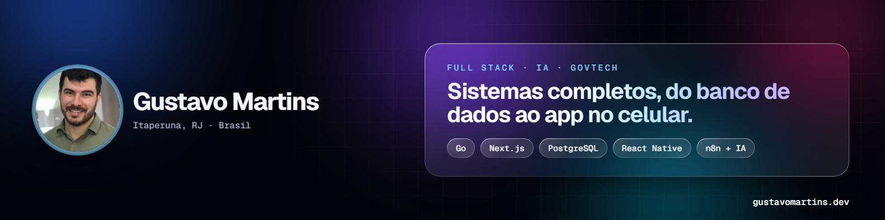
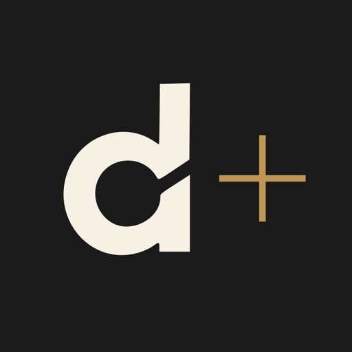

  

  
  
  
  

### Olá! Eu sou o Gustavo 👋

Há mais de 17 anos trabalho com tecnologia no setor público e hoje construo **sistemas completos — do banco de dados ao app no celular — com IA no centro**.

- 🏛️ **Fundador da [Usegov](https://usegov.com.br)**: soluções digitais para Secretarias de Saúde (GovFarma, e-SUS em Nuvem e Ponto Digital)
- 🖥️ **Chefe de TI da Prefeitura de São José de Ubá (RJ)** desde 2009: infraestrutura, segurança e LGPD
- 📱 **Apps publicados** na App Store e no Google Play
- 🤖 **Agentes de IA e automação** com n8n, WhatsApp, OpenAI e Claude
- 🎓 Último período da **Graduação em IA e Automação Digital** (UniFECAF + Rocketseat), com formatura em fev/2027

### 🛠️ Stack

**Backend** &nbsp;

**Frontend & Mobile** &nbsp;

**IA & Automação** &nbsp;

**Dados & Infra** &nbsp;

### 📱 Apps na App Store e no Google Play

<table>
  <tr>
    <td width="50%" valign="top">
      
      <b>Despertar+</b> 
      Plataforma de mentoria com trilhas em vídeo, gamificação e comunidade. 
      Next.js · Go · PostgreSQL · Expo  
      <a href="https://apps.apple.com/br/app/despertar/id6808293873">App Store</a> ·
      <a href="https://play.google.com/store/apps/details?id=br.com.despertarmais">Google Play</a> ·
      <a href="https://despertarmais.com.br">Site</a>
    </td>
    <td width="50%" valign="top">
      
      <b>LET Club</b> 
      App de emagrecimento com aulas em streaming e acesso liberado por webhook de pagamento. 
      Expo · Go · Next.js · PostgreSQL  
      <a href="https://apps.apple.com/br/app/let-club/id6787450677">App Store</a> ·
      <a href="https://play.google.com/store/apps/details?id=com.letclub.app">Google Play</a>
    </td>
  </tr>
</table>

### 🚀 Projetos em produção

| Projeto | O que faz | Stack |
|---|---|---|
| [**Usegov**](https://usegov.com.br) | Soluções para Secretarias de Saúde, com CRM e agente de IA | PHP · Claude · WhatsApp |
| [**Domínio Financeiro**](https://dominiofinanceiro.online) | Finanças pessoais com assistente de IA no WhatsApp | Next.js · Go · OpenAI |
| [**SevenFlow**](https://sevenflow.site) | Automação de WhatsApp em escala com gestor de IA | Next.js · Go · Claude · Redis |
| **Ponto Digital** | Ponto biométrico em produção na Prefeitura de Laje do Muriaé | Node.js · C# · React Native |
| [**Radar de Licitações**](https://github.com/gustavo9br/Radar-de-Licita-es) | Cruza o PNCP com o CATMAT para apontar indícios de sobrepreço | TypeScript · APIs públicas |
| [**AI Operations**](https://github.com/gustavo9br/ai-operations) | Central de demandas com agentes de IA e aprovação humana | n8n · OpenAI · PostgreSQL |
| [**Omni AI**](https://github.com/gustavo9br/Omni-ai) | RAG corporativo que responde citando a fonte | FastAPI · pgvector |
| [**Órbita**](https://github.com/gustavo9br/orbita) | Sistema pessoal de produtividade com IA | React · Node.js · OpenAI |

➡️ Todos os 18 projetos estão em **[gustavomartins.dev](https://gustavomartins.dev)**.

  Self-hosted com Docker Swarm, Traefik e Portainer · deploy com GitHub Actions → GHCR → webhook

